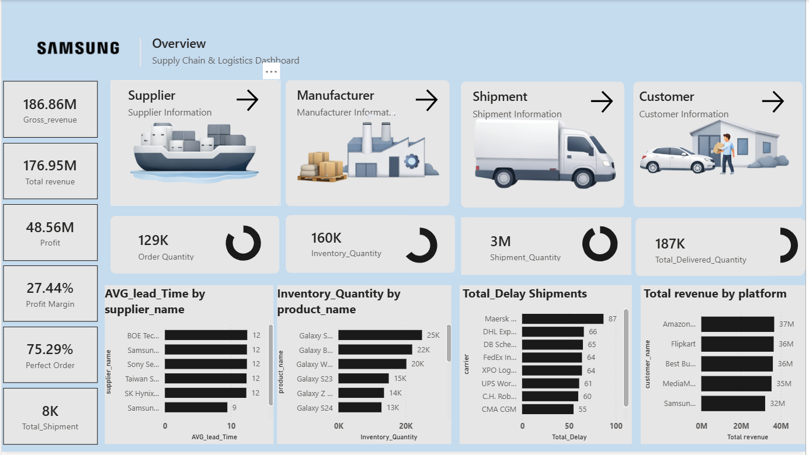
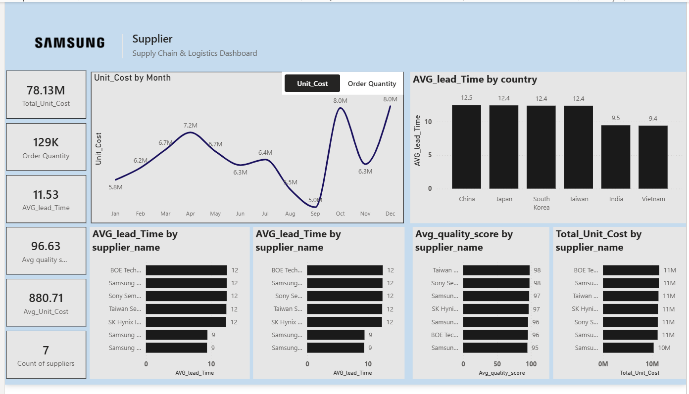
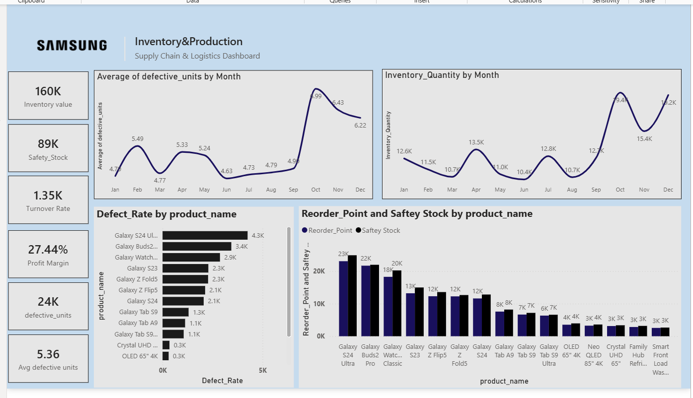
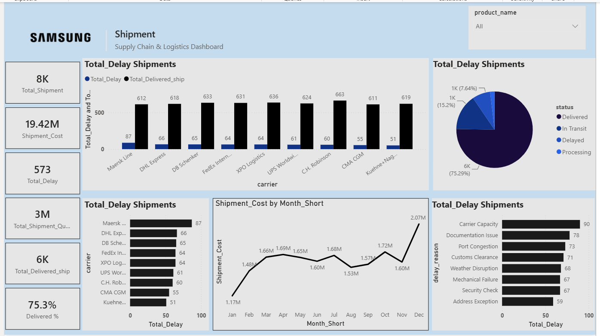
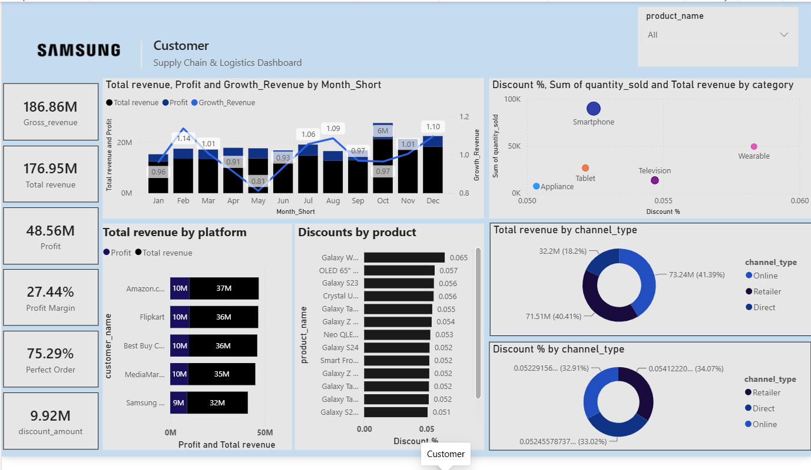
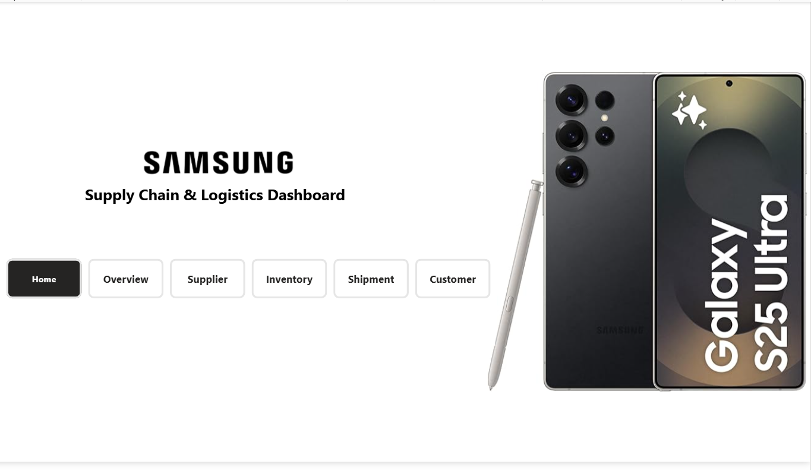
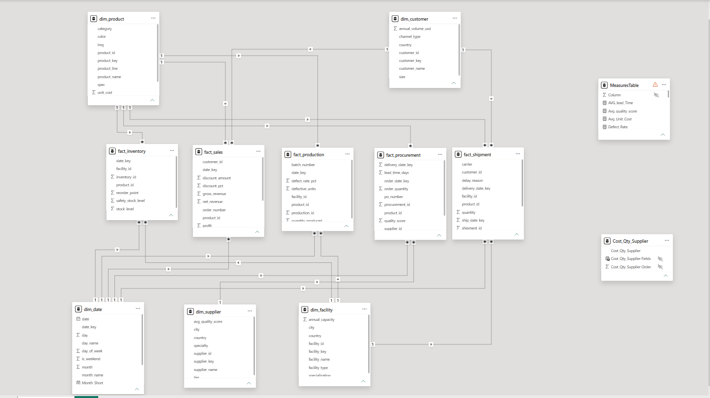

# Samsung Supply Chain & Logistics | Power BI

### Five business functions. Ten connected tables. One supply chain story.

> **Where does supply chain performance slow down — at the supplier, on the production floor, in inventory, or during delivery?**
>
> I built an interactive Power BI analytics solution to explore the journey from **procurement to customers** — connecting supplier performance, inventory, production, shipments, and sales in one decision-focused experience.

**Power BI** · **DAX** · **Power Query** · **Galaxy Schema / Fact Constellation** · **Business Intelligence** · **Supply Chain Analytics**



<p align="center"><strong>Explore the full report:</strong> <a href="screenshots/suppliers.png">Suppliers</a> · <a href="screenshots/inventory-production.png">Inventory & Production</a> · <a href="screenshots/shipments.png">Shipments</a> · <a href="screenshots/customers-sales.png">Customers & Sales</a></p>

---

## The business challenge

Supply chain performance is rarely defined by one KPI. Supplier lead times affect procurement planning; inventory levels must be balanced against production needs; delivery execution influences fulfillment; and sales performance completes the picture.

**The goal:** provide a single interactive reporting experience that helps decision-makers explore operational efficiency, identify areas for investigation, and prioritize data-informed actions across the supply chain.

## At a glance

| Sales & profitability | Supply chain & fulfillment |
|:--|:--|
| **176.95M** net revenue | **7,500** shipment records |
| **48.56M** profit | **75.29%** delivered shipment share |
| **27.44%** profit margin | **573** delayed shipments |
| **186.86M** gross revenue | **11.53 days** average procurement lead time |

*Figures are calculated from the included project dataset and match the displayed dashboard KPIs at the report's overall level. Monetary figures retain the dataset's reporting units.*

## Insights that stand out

### 01 · Sales channels reveal where revenue is concentrated

**Online contributed 73.24M (41.39%)** of net revenue, closely followed by **Retailers at 71.51M (40.41%)**. Direct sales accounted for **32.20M (18.20%)**.

**Business direction:** compare margins, discount behavior, and product mix across channels to understand where growth is most valuable — not only where revenue is highest.

### 02 · Delivery performance deserves a closer operational look

Out of **7,500 shipment records**, **5,647** were marked **Delivered (75.29%)**, while **573 (7.64%)** were marked **Delayed**.

**Carrier Capacity (90)** and **Documentation Issues (78)** represent **168 of the 573 delayed shipments — 29.3%** of recorded delay reasons.

**Business direction:** prioritize carrier capacity planning and documentation workflows for further investigation. A shipment's current status should not be confused with an on-time delivery SLA.

### 03 · Supplier lead times vary across locations

The supplier analysis shows average procurement lead times of approximately **12.5 days for China** versus **9.4 days for Vietnam**, a gap of about **3.1 days**.

**Business direction:** investigate supplier lead-time differences alongside quality scores, costs, and order quantities before making sourcing decisions.

### 04 · Inventory demand for attention is not uniform across the year

The inventory view shows approximately **19.4K units in October** compared with **10.4K in June** (monthly aggregated stock levels), suggesting noticeably different inventory positions across reporting months.

**Business direction:** examine product-level stock levels against reorder points and safety-stock requirements to identify where replenishment policies may need closer review.

> These are **descriptive observations**, not claims that specific operational interventions were implemented or caused improvements. Full supporting figures and possible actions are in [Business Insights](docs/business-insights.md).

---

## Explore the dashboard

The report includes a **Home/navigation page** and **five analytical pages**.

### 1. Executive Overview · The entire supply chain in one view

Track revenue, profit, procurement, inventory, and shipment KPIs. Move from the executive picture into functional views using dashboard navigation.


### 2. Supplier Analysis · Cost, quality, and lead time

Compare supplier lead times by company and country, monitor purchasing costs and order volumes, and explore supplier quality scores.



### 3. Inventory & Production · Stock readiness meets manufacturing performance

Explore inventory quantities, reorder points, safety-stock indicators, and production defects by product and month.



### 4. Shipment Analysis · Visibility into logistics execution

Monitor shipment statuses, carrier-level delays, delay reasons, and shipping costs over time.



### 5. Customer & Sales Analysis · Revenue, profit, and channels

Analyze revenue and profit by customer, product, and channel alongside discounts and category-level demand.



<details>
<summary><strong>See the Home / Navigation screen</strong></summary>



</details>

---

## The data model · Galaxy Schema

This project uses a **fact constellation (Galaxy Schema)** structure: multiple fact tables are organized around shared business dimensions to support analytics across functional areas.

| Five fact tables | Five dimension tables |
|:--|:--|
| `fact_sales` | `dim_customer` |
| `fact_procurement` | `dim_supplier` |
| `fact_inventory` | `dim_product` |
| `fact_production` | `dim_facility` |
| `fact_shipment` | `dim_date` |

The report also contains supporting calculation tables, including `MeasuresTable` and `Cost_Qty_Supplier`. The table pairings above are **inventory lists**, not one-to-one mappings.



### What I worked on

- **Data preparation:** organized the supplied CSV source tables for reporting with Power Query.
- **Data modeling:** built a multi-fact model with shared dimensions to connect the major supply chain functions.
- **DAX measures:** created business metrics for revenue, profit, margin, supplier lead time, inventory, production, and shipment performance.
- **Interactive analytics:** designed KPI cards, trend charts, categorical comparisons, slicers, and page navigation for different operational audiences.
- **Business storytelling:** structured five functional pages around questions a supply chain team needs to answer.

For table details and definitions, see the [Data Dictionary](docs/data-dictionary.md) and [Model & KPI Guide](docs/model-and-kpis.md).

## Repository contents

```text
Samsung-Supply-Chain-Logistics-PowerBI/
├── README.md
├── dashboard/
│   └── Samsung.pbix
├── data/
│   ├── dim_customer.csv
│   ├── dim_date.csv
│   ├── dim_facility.csv
│   ├── dim_product.csv
│   ├── dim_supplier.csv
│   ├── fact_inventory.csv
│   ├── fact_procurement.csv
│   ├── fact_production.csv
│   ├── fact_sales.csv
│   └── fact_shipment.csv
├── screenshots/
│   ├── home.png
│   ├── overview.png
│   ├── suppliers.png
│   ├── inventory-production.png
│   ├── shipments.png
│   ├── customers-sales.png
│   └── data-model.png
└── docs/
    ├── business-insights.md
    ├── data-dictionary.md
    └── model-and-kpis.md
```

## Open and explore the Power BI report

1. Download [`dashboard/Samsung.pbix`](dashboard/Samsung.pbix).
2. Open the report with **Microsoft Power BI Desktop**.
3. Use the **Home** page to navigate between the five analytical views, or open report pages directly.
4. Explore the filters, KPI cards, trends, and category breakdowns. The ten underlying CSV source files are included in [`data/`](data/).

If you need to **refresh** the imported data on your computer, update the source paths in **Power Query** to point to your local `data/` directory.

**Dataset reference:** [Project dataset and assets folder](https://drive.google.com/drive/folders/18b7oPFTuvEIxb5c79WNc-5AMij88Tclm).

---

### Let's connect

Interested in **Power BI, Business Intelligence, Data Analytics, or Supply Chain Analytics**? Explore the dashboard, review the data model, and connect with me through my GitHub profile.

**Built with Power BI — from raw business data to an interactive analytics experience.**
